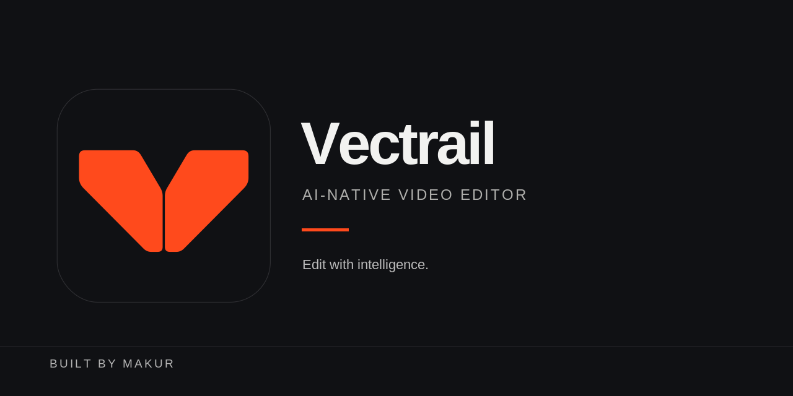

<div align="center">



# Vectrail

**AI-native video editing for Windows.**  
Fast timeline, real-time WebGL grading, FFmpeg export, local transcription, agent automation, and camera import — in one open-source editor.

[](https://github.com/makur6371/Vectrail/releases)
[](#download)
[](LICENSE)

[Download](#download) · [Features](#features) · [AI & MCP](#ai-agent-integration) · [Build](#development--testing)

</div>

<div align="center">

https://github.com/makur6371/Vectrail/releases/download/v1.2.0/vectrail-teaser-v2.0.0.mp4

**4K 60fps product teaser** — click to watch.

</div>

---

## Why Vectrail

Vectrail is a desktop editing studio built around speed and control. It keeps heavy media work local, exposes real timeline and color tools, and adds AI where it is useful — planning cuts, understanding media, and driving the editor through MCP.

| Area | What you get |
| --- | --- |
| **Timeline** | Multi-track video/audio, ripple delete, speed ramps, reverse, freeze frames, ducking, linked clips, snapping, markers, and editable shortcuts. |
| **Color & Preview** | Real-time WebGL2 compositing, 11 built-in looks, `.cube` LUT import/bake, color wheels, direct canvas transform handles, and frame-accurate scrubbing. |
| **Media** | Hover-scrub thumbnails, source `I/O` ranges, proxy/remux support for difficult formats, Whisper transcription, and automatic scene tags. |
| **Export** | Hardware H.264/HEVC with software fallback, Lanczos + CAS upscaling, loudness normalization, caption burn-in, and social aspect presets. |
| **AI & Automation** | Magic AI bar, OpenAI-compatible Cloud AI, Codex/Claude connectors, and a local 45-tool MCP server. |
| **Camera Import** | DJI wireless discovery, live diagnostics, resumable original-file transfer, USB mass-storage ingest, checksum verification, and auto project import. |

## Features

- **Real-time WebGL2 preview** with multi-track compositing, transitions, fades, captions, zoom/pan curves, exposure, contrast, saturation, temperature, tint, and lift-gamma-gain wheels.
- **Professional non-linear timeline** with continuous filmstrip tiling, `V/A` tracks, split (`S`), shuttle (`J`/`K`/`L`), ripple delete (`Shift+Delete`), piecewise speed ramps, reverse playback, track ducking, and undo/redo.
- **Universal media support** through `vectrail-media://` byte-range streaming plus background FFmpeg proxies for `.mkv`, `.mxf`, `.avi`, and incompatible `.mov` profiles.
- **Local Whisper transcription** and automatic scene tags such as `bright`, `night`, `action`, `people`, `vivid`, and `sharp`.
- **Magic AI bar** with `@` mention autocomplete, live execution steps, one-click undo, Cloud AI configuration, and agent session logs.
- **Core 16 / Pro 32 editing skills** and composable workflow templates.
- **Universal video link importer** — paste a share link and get the media: three
  resolver lines (a vendored local DTK signing core for Douyin and TikTok, the
  public BugPk API, and yt-dlp), an inline preview player, one-click quality
  selection, resumable direct downloads, FFprobe verification, and automatic
  library import.
- **DJI import plugin** for BLE/Wi-Fi camera discovery, live connection health, resumable downloads, USB mass-storage ingest, SHA-256 verification, simulated-camera testing, and automatic library import.
- **Extension marketplace** for managing ready and planned integrations, including iPhone import, digital human, voice cloning, and watch folders.
- **FFmpeg export engine** with hardware probing, audio-only WAV, aspect presets, `.cube` LUT baking, and caption burn-in.

## Download

Download the latest Windows build from the [Release page](https://github.com/makur6371/Vectrail/releases/latest):

| Asset | Use |
| --- | --- |
| `Vectrail.Setup.*.exe` | Recommended NSIS installer for Windows 10/11. |
| `Vectrail-Windows-Portable-*-x64.exe` | Portable single-file executable. |
| `vectrail-teaser-*.mp4` | Product teaser. |

### Prerequisites

- Windows 10/11 x64.
- FFmpeg and FFprobe available on `PATH`, for example:

```powershell
winget install Gyan.FFmpeg
```

For source builds, install Node.js 20 or newer.

## AI Agent Integration

1. Launch Vectrail and open **Settings**.
2. In the Magic popover, configure any **OpenAI-compatible Cloud AI** endpoint: `Base URL`, `API Key`, and `Model`.
3. Under **AI Agents & MCP Server**, click **Connect** for **Codex**, **Claude Code**, or **Claude Desktop**.
4. Vectrail registers its local stdio bridge automatically. The HTTP MCP endpoint is `127.0.0.1:47920/mcp`.

Portable builds copy the bridge to `%APPDATA%\Vectrail\Runtime\vectrail-mcp-bridge.js`, so agent configuration remains stable between launches.

## Development & Testing

```powershell
npm install
npm run typecheck
npm test
npm start
```

Package Windows binaries:

```powershell
npm run dist:win
```

If GitHub is unavailable and you want to reuse the local Electron runtime:

```powershell
npm run dist:win:offline
```

Outputs land in `release/`:

```text
release/
├── Vectrail Setup <version>.exe
├── Vectrail-Windows-Portable-<version>-x64.exe
└── win-unpacked/Vectrail.exe
```

## Architecture

```text
src/
├── main/       Electron process, media protocol, FFmpeg pipeline, plugins, MCP.
├── renderer/   React UI, WebGL2 compositor, timeline, inspector, and modals.
└── shared/     Cross-process project model, LUT engine, caption layout, templates.
tests/          Unit and integration tests with Vitest.
```

- **Main process**: media protocol handler, FFmpeg analyzer/exporter/proxy pipeline, DJI plugin transport, Cloud AI connector, and MCP HTTP + stdio server.
- **Renderer**: React + Tailwind workspace, WebGL2 color compositor, Web Audio mixer, timeline, library, inspector, and AI panels.
- **Shared**: deterministic project model, `.cube` parsing/baking, caption layout, beat planning, themes, and shortcut definitions.

## Live QA

With Vectrail running and fixtures in `%TEMP%\vectrail-live-test`:

```powershell
npm run qa:live
```

The script imports fixtures, builds a beat-synced cut, applies grading, seeks the playhead, inspects a rendered frame, and saves the project.

## Documentation

- [DJI plugin architecture & compatibility](docs/DJI_PLUGIN_REPORT.md)
- [Editing skills and templates](docs/VIDEO_EDITING_SKILLS_AND_TEMPLATES.md)
- [Project notes and roadmap](docs/TODO.md)

## Attribution & License

Built by [Makur](https://github.com/makur6371).  
Inspired by [robbietilton/Editroom](https://github.com/robbietilton/Editroom) for macOS.

Released under the [MIT License](LICENSE). DJI and Osmo are trademarks of their respective owners; this project is independent and not affiliated with or endorsed by DJI.
